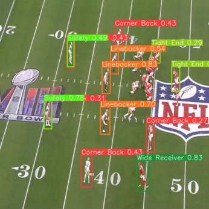
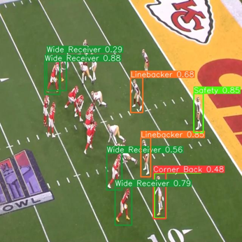

<div align="center">

# 🏈 The Playmakers

**Real-Time NFL Player Position Classification**

*A deep learning framework for identifying player positions from pre-snap formations using contextual object detection*

*John Michael Slezak, Atif Khan, Chenhao Lu, Ruida Zeng*

*Department of Computer Science, Brown University*

[](Final%20Report.pdf)
[](https://www.python.org/)
[](https://github.com/ultralytics/ultralytics)
[](LICENSE)

[Overview](#overview) | [Features](#features) | [Installation](#installation) | [Project Structure](#project-structure) | [Results](#results) | [Citation](#citation)

---

</div>

## Overview

**Playmakers** is a computer vision framework for classifying NFL player positions from pre-snap formations using **YOLOv8**. The unique challenge is that all players appear visually similar—the model must learn from **spatial context and positioning** rather than individual features.

- ✅ **Context-Aware Detection** — Leverages player positioning and formation patterns
- ✅ **Real-Time Performance** — Optimized for live game footage analysis
- ✅ **Custom Dataset** — 503 annotated images from NFL championship games
- ✅ **8 Position Classes** — WR, CB, Safety, LB, RB, QB, TE, Fullback

---

## Features

<table>
<tr>
<td width="50%">

### 🎯 End-to-End Pipeline
From data preprocessing to real-time inference, all components are production-ready.

### 📊 Custom Dataset
Processed NFL footage from 2024 Super Bowl + AFC/NFC Championships with 500+ annotated images.

</td>
<td width="50%">

### ⚡ Real-Time Inference
YOLOv8 architecture enables blazing fast predictions suitable for live analysis.

### 📈 Comprehensive Evaluation
Detailed metrics including confusion matrices, F1 curves, and precision-recall analysis.

</td>
</tr>
</table>

---

## Installation

### Prerequisites

- Python 3.8+
- CUDA-capable GPU (recommended for training)

### Setup

```bash
# Clone the repository
git clone https://github.com/yourusername/the-playmakers.git
cd the-playmakers

# Create virtual environment
python -m venv venv
source venv/bin/activate  # On Windows: venv\Scripts\activate

# Install dependencies
pip install -r requirements.txt
```

### Download Dataset

The dataset can be downloaded from Roboflow or extracted from the zip files in `WR/datasets/`:

```python
# Option 1: From Roboflow
from roboflow import Roboflow
rf = Roboflow(api_key="YOUR_API_KEY")
project = rf.workspace("cs-1430").project("wr-finder")
version = project.version(3)
dataset = version.download("yolov8")

# Option 2: Extract from included zip files
# Unzip WR/datasets/NewWRData.zip
```

---

## Project Structure

```
the-playmakers/
│
├── 📄 README.md                    # Project documentation
├── 📄 requirements.txt             # Python dependencies
├── 📄 .gitignore                   # Git ignore rules
├── 📄 Final Report.pdf             # Academic paper (PDF)
├── 📄 Final Poster.pptx            # Project poster presentation
│
├── 📁 WR/                     # Main project data and code
│   │
│   ├── 📁 notebooks/               # Jupyter notebooks
│   │   ├── main.ipynb              # Data loading + color matching + YOLO detection
│   │   ├── WRYOLOCUSTOM.ipynb      # YOLOv8 training via Roboflow (primary)
│   │   ├── player_detection.ipynb  # YOLOv5 training pipeline
│   │   ├── test_vis.ipynb          # Model evaluation & visualization (Colab)
│   │   ├── newwr_test_vis.ipynb    # Model evaluation (local Windows)
│   │   └── field_filter.ipynb      # Field preprocessing experiments
│   │
│   ├── 📁 images/                  # Sample images
│   │   ├── afc_championship_2024.jpg           # Input image (2024 AFC Championship)
│   │   ├── afc_championship_2024_processed.jpg # Processed output after filtering
│   │   ├── superbowl_lviii_detection_1.png     # Detection example (Super Bowl LVIII)
│   │   └── superbowl_lviii_detection_2.png     # Detection example (Super Bowl LVIII)
│   │
│   ├── 📁 datasets/                # Dataset archives
│   │   ├── NewWRData.zip           # Main dataset (train/val/test splits)
│   │   ├── runs.zip                # Training runs (weights, logs, metrics)
│   │   ├── WR Finder.v1i.yolov8.zip      # Roboflow YOLOv8 format
│   │   └── WR Finder.v1i.tensorflow.zip  # Roboflow TensorFlow format
│   │
│   ├── 📁 scripts/                 # Python scripts
│   │   └── filter_field.py         # Standalone field filtering script
│   │
│   └── 📁 docs/                    # Additional documentation
│       └── color matching poster stuff.docx
│
├── 📁 Final Report/                # LaTeX source for academic paper
│   ├── main.tex                    # Main LaTeX document
│   ├── ProjectFinal_ProjectReportTemplate.bib    # Bibliography
│   ├── ProjectFinal_ProjectReportTemplate.pdf    # Compiled PDF
│   ├── architecture.png            # YOLOv8 architecture diagram
│   ├── confusion_matrix.png        # Classification confusion matrix
│   ├── confidence_curve.png        # F1-confidence curve
│   ├── precison_curve.png          # Precision-recall curve
│   ├── color_matching_1.png        # Color matching result example
│   ├── color_matching_2.png        # Color matching result example
│   ├── matches_1.png               # Correct detection example
│   ├── matches_2.png               # Correct detection example
│   ├── mismatch_1.jpg              # Incorrect detection example
│   ├── mismatch_2.jpg              # Incorrect detection example
│   ├── LabelingExample.png         # Roboflow labeling screenshot
│   └── [LaTeX style files]         # cvpr.cls, cvpr.sty, etc.
│
└── 📁 Templates/                   # Course templates (CS 1430)
    ├── README.md                   # Template instructions
    ├── ProjectFinal_ProposalTemplate.tex
    ├── ProjectFinal_ProgressReportTemplate.tex
    ├── ProjectFinal_ProgressReportTemplate.pdf
    ├── ProjectFinal_PosterTemplate.pptx
    ├── ProjectFinal_PresentationTemplate.pptx
    └── ProjectFinal_ProjectReportTemplate/
```

---

## Notebooks Guide

| Notebook | Purpose | Platform |
|----------|---------|----------|
| `main.ipynb` | Data exploration, color matching algorithm, base YOLO detection | Colab |
| `WRYOLOCUSTOM.ipynb` | **Primary training notebook** - YOLOv8 with Roboflow | Colab |
| `player_detection.ipynb` | Alternative YOLOv5 training (50 epochs) | Colab |
| `test_vis.ipynb` | Model evaluation with NMS + visualization | Colab |
| `newwr_test_vis.ipynb` | Same as above, configured for local execution | Local |
| `field_filter.ipynb` | Field preprocessing to remove logos/end zones | Colab |

### Quick Start with Notebooks

```bash
# For Google Colab notebooks, upload to Colab and run
# For local notebooks:
cd "WR/notebooks"
jupyter notebook newwr_test_vis.ipynb
```

> **Note:** Notebooks contain hardcoded paths for Google Drive or local directories. Update the `base_dir` and `data_dir` variables to match your setup.

---

## Dataset Details

| Archive | Contents |
|---------|----------|
| `NewWRData.zip` | 503 labeled images split into train/val/test in YOLO format |
| `runs.zip` | Training outputs: model weights (`best.pt`), logs, metrics plots |
| `WR Finder.v1i.yolov8.zip` | Roboflow export in YOLOv8 format |
| `WR Finder.v1i.tensorflow.zip` | Roboflow export in TensorFlow format |

### Position Classes (8 total)

| ID | Position | Description |
|----|----------|-------------|
| 0 | Corner Back | Defensive backs covering receivers |
| 1 | Fullback | Offensive blocker/runner |
| 2 | Linebacker | Middle defensive players |
| 3 | Quarterback | Offensive play caller |
| 4 | Running Back | Primary ball carrier |
| 5 | Safety | Deep defensive backs |
| 6 | Tight End | Offensive lineman/receiver hybrid |
| 7 | Wide Receiver | Primary pass catchers |

---

## Results

<div align="center">

### Sample Detections




</div>

### Performance Metrics

| Metric | Value |
|--------|-------|
| **mAP@0.5** | 0.759 |
| **F1 Score** | 0.62 @ conf 0.229 |
| **Best Class (WR)** | 94.2% precision |
| **Corner Back** | 88.5% precision |
| **Safety** | 87.9% precision |

<details>
<summary><b>📊 View Detailed Evaluation Charts</b></summary>

<br>

**F1-Confidence Curve**


**Precision-Recall Curve**


**Confusion Matrix**


</details>

---

## Methodology

### Two Detection Approaches

#### 1. Color Matching (Experimental)
Located in `WR/notebooks/main.ipynb`:
- Converts images to LAB color space
- Detects players by team jersey colors
- Identifies offense by formation width
- Finds WRs by edge positioning
- **Limitation**: Sensitive to lighting, logos, end zones

#### 2. YOLOv8 Object Detection (Primary)
Located in `WR/notebooks/WRYOLOCUSTOM.ipynb`:
- Single-pass detection for real-time performance
- Grid-based localization with non-max suppression
- Trained on 503 custom-labeled images
- 8 position classes

---

## Team Contributions

| Member | Contribution |
|--------|-------------|
| **John Michael Slezak** | Dataset creation, 503 image labels, YOLO training, report writing |
| **Atif Khan** | YOLO research & implementation, model training, technical docs |
| **Chenhao Lu** | Detection research, pre-trained YOLO testing, color matching |
| **Ruida Zeng** | Field filters, new dataset testing, results analysis, visualization |

---

## Future Directions

- 🔄 **Expanded Dataset** — More diverse formations and player setups
- 🤖 **Alternative Models** — Experiment with DETR or Swin Transformer
- 📹 **Player Tracking** — In-play movement analysis across frames
- 🎮 **Live Integration** — Real-time broadcast overlay support

---

## Citation

```bibtex
@project{playmakers2024,
  title={The Playmakers: NFL Position Classification Through YOLO},
  author={Slezak, John Michael and Khan, Atif and Lu, Chenhao and Zeng, Ruida},
  institution={Brown University},
  course={CS 1430 Computer Vision},
  year={2024}
}
```

---

<div align="center">

**TA Mentor:** Joel Manasseh | **Professor:** Srinath Sridhar

*Brown University CS 1430 — Computer Vision Final Project*

For questions or suggestions, please reach out via [GitHub Issues](../../issues)

</div>
